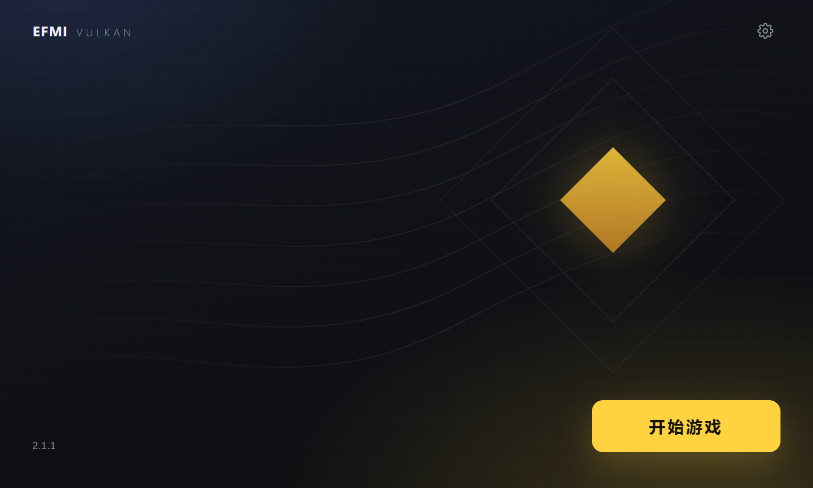

# EFMI Vulkan Launcher

A launcher for Arknights: Endfield with [EFMI Vulkan](https://github.com/loyal37/efmi-vulkan): it starts the
game on its Vulkan renderer and loads the EFMI Vulkan layer itself, so the installed EFMI (XXMI) Mods
show without changing any setting of the XXMI Launcher.

Work in progress. What is verified, and where (build, a sandbox program, the game), is in
[the current state](.ai-memory/CURRENT_STATE.md).



## What it does

- One button starts the game: the process is created suspended, `efmi_vk_inject.dll` is loaded with a
  plain remote `LoadLibraryW`, and the process is resumed. Nothing is hidden and nothing works against
  the anti-cheat. Outside Steam the game is created as the child of the official launcher's `Games.exe`
  (created suspended, never run), as the XXMI Launcher starts it. Using it is at your own risk for your account.
- Settings: the game folder, the official launcher's folder, the EFMI folder, and the folder EFMI Vulkan is installed in. On the first
  run the first three are read from the XXMI Launcher's configuration, which is never written.
- Installs and updates EFMI Vulkan from its GitHub releases or from a local release archive. An archive
  is checked whole before installed files are replaced.
- Only the core is elevated, and only when the game needs it; the window is not.

## Parts

| Path | Content |
| --- | --- |
| `core/` | C++17 library and the command line `efvl_core.exe`: settings, install, update, start with injection |
| `shell/` | The window, a Win32 host of WebView2 |
| `ui/` | The page; every text of the interface is in `ui/strings.zh-CN.json` |
| `scripts/`, `tests/` | Build and checks |
| `.ai-memory/` | Project memory for agents; `AGENTS.md` is the working agreement |

## Build and check

Windows x64, the MSVC build tools, Python 3.12, and under `F:\vulkan` (or `EFVL_DEPS`): the WebView2 SDK
1.0.2903.40 (NuGet `Microsoft.Web.WebView2`), miniz 3.0.2 and nlohmann/json 3.11.3.

```bat
python scripts\build.py
python scripts\check_text.py
python tests\check_core.py
python tests\check_inject.py
python tests\check_update.py
python tests\check_ui.py
```

The checks use a Vulkan test program of the EFMI Vulkan project in place of the game, a stand-in
server in place of GitHub, and folders under `build/tests`. They never start the game.

## Command line

```bat
efvl_core status
efvl_core set --game DIR --efmi DIR --layer DIR
efvl_core check-update
efvl_core update
efvl_core install --archive EFMI-Vulkan-X.Y.Z.zip
efvl_core start
```

## Licence

GPL-3.0 (`LICENSE`). Third-party components: `THIRD_PARTY_NOTICES.md`.
